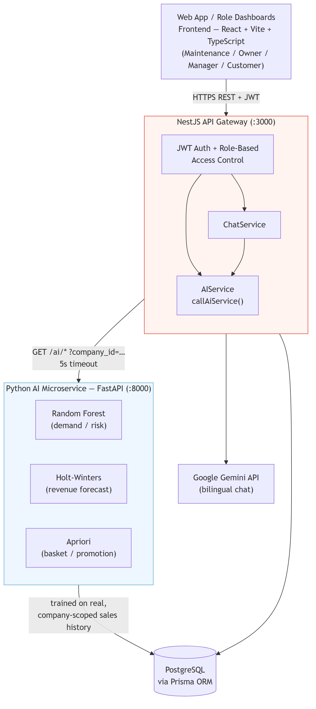
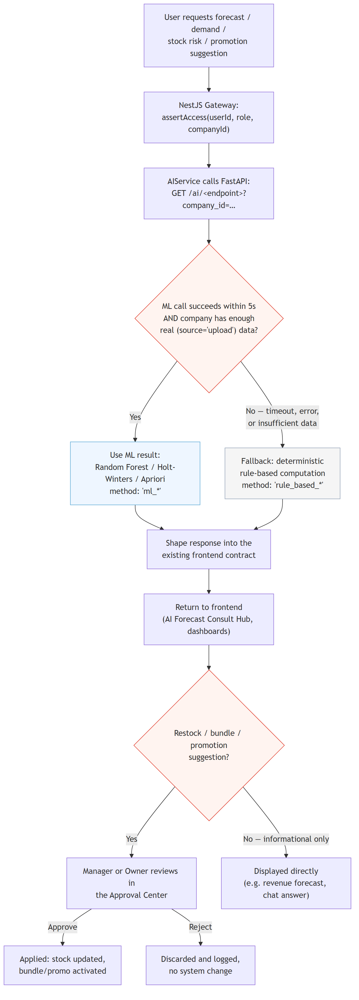
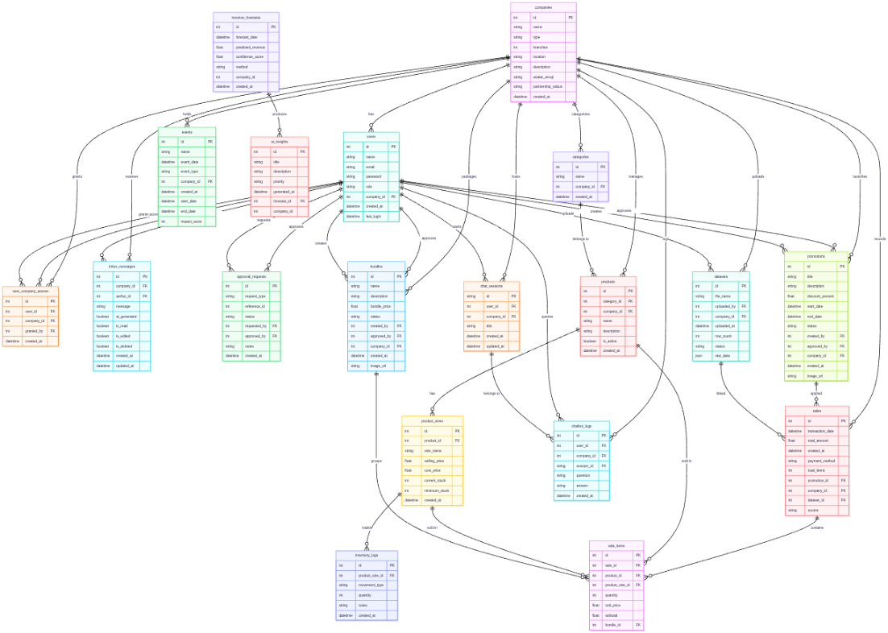

# AIBISPRO

**AI-Powered Decision Support and Business Intelligence System for Retail & Inventory Management**

AIBISPRO is a multi-tenant business intelligence platform for F&B/retail operators (cafés, restaurants, cloud kitchens). It combines real-time financial dashboards, an approval-based workflow for restocking/bundling/promotions, and machine-learning-backed demand forecasting and market-basket analysis — all grounded in each company's real, uploaded sales data, with a bilingual (English/Bahasa Indonesia) conversational AI assistant on top.

---

## Table of Contents

1. [Architecture](#architecture)
2. [Tech Stack](#tech-stack)
3. [Features](#features)
4. [Project Structure](#project-structure)
5. [Getting Started](#getting-started)
6. [Environment Variables](#environment-variables)
7. [Demo Accounts](#demo-accounts)
8. [Database Design](#database-design)
9. [Machine Learning](#machine-learning)
10. [API Overview](#api-overview)
11. [Known Limitations & Roadmap](#known-limitations--roadmap)
12. [Troubleshooting](#troubleshooting)

---

## Architecture

AIBISPRO runs as three independent services:

| Service | Tech | Port | Role |
|---|---|---|---|
| **Frontend** | React 19 + Vite + TypeScript | `5174` | Role-based dashboards, no client-side router (view-switching via state) |
| **Backend Gateway** | NestJS + Prisma + PostgreSQL | `3000` | Auth, RBAC, business logic, orchestrates the AI microservice |
| **AI Microservice** | Python + FastAPI | `8000` | Random Forest / Holt-Winters / Apriori inference on real sales data |

The backend calls the AI microservice for every ML-backed feature (forecast, demand, risk, promotion, recommendations), and **automatically falls back to deterministic rule-based computation** if the ML service is unreachable, times out, or a company doesn't yet have enough real sales history — the platform never hard-fails because of the ML layer.





---

## Tech Stack

| Category | Technologies |
|---|---|
| Frontend | React 19, Vite, TypeScript, Tailwind CSS, Recharts, Motion (framer-motion), lucide-react |
| Backend | NestJS, TypeScript, Prisma ORM, JWT (`@nestjs/jwt`), bcrypt |
| AI Microservice | FastAPI, Pandas, NumPy, scikit-learn (Random Forest), statsmodels (Holt-Winters), mlxtend (Apriori), SQLAlchemy |
| Database | PostgreSQL (run via Docker) |
| Conversational AI | Google Gemini (`@google/genai`), `gemini-flash-lite-latest` |
| Currency | Live rate from `open.er-api.com`, refreshed hourly |
| Dev tooling | Docker, Git, Playwright (E2E verification), Claude Code |

---

## Features

**Roles & access**
- 4 roles — `MAINTAINANCE` (platform admin) → `OWNER` → `MANAGER` → `CUSTOMER` (guest) — with cascading, per-company access grants (`user_company_access`, tracks who granted access to whom).
- JWT auth, bcrypt password hashing, role guards on every route.
- Hierarchical credential-change requests (Owner's changes require Maintenance approval; Owner sets Manager credentials directly).

**Dashboards & analytics**
- Executive Summary with real-time-filtered financial KPIs (Daily/Weekly/Monthly/Yearly/Total) driven entirely by real uploaded data (`sales.source = 'upload'`), never seed/demo data.
- Financial Intelligence Center — revenue/expense/profit/margin/cash-flow/inventory trend charts over configurable date ranges.
- Live USD ⇄ IDR currency conversion, fetched from a public exchange-rate API and shown in the navbar (not a hardcoded constant).

**Approval Center (unified)**
- Restock requests, bundle proposals, and promotions merged into a single history/queue with status (pending/approved/rejected), reviewer notes, and a read-only detail modal per item.
- Bidirectional restock authority — either Owner or Manager can initiate a request; whichever role did **not** initiate it has review authority (enforced both client- and server-side).
- CSV/Excel import with alias-based flexible column matching and cross-import + within-file deduplication; full-detail multi-sheet export.

**Machine learning (real, not simulated)**
- **Random Forest** (scikit-learn) — per-product demand prediction and stock-risk scoring, trained on real, company-scoped, deduplicated-source sales history.
- **Holt-Winters** (statsmodels) — daily revenue forecasting with confidence bounds.
- **Apriori** (mlxtend) — market-basket association rules driving bundle/promotion suggestions.
- Every ML endpoint has a company-scoped, timeout-bounded call from the backend, with automatic fallback to the original rule-based logic — verified by deliberately killing the ML service and confirming the platform keeps serving valid data.
- A real, reproducible model-comparison script (`ai-service/scripts/evaluate_models.py`) evaluates Random Forest against Holt-Winters on the same held-out real data; results in [`ai-service/MODEL_COMPARISON.md`](./AIBISPRO-Backend-Made/ai-service/MODEL_COMPARISON.md).

**Conversational AI**
- Gemini-powered assistant grounded strictly in each company's real data (forecasts, stock risk, promotions, demand) — answers in whichever language the user writes in, and explicitly says when it doesn't have the data to answer rather than guessing.
- Three-tier fallback: custom OpenAI-compatible endpoint → Gemini → deterministic template answers, so the assistant degrades gracefully rather than failing outright.

**Customer experience**
- Guest storefront (no account needed) — browse menu, prices, and active promotions per company.
- Split login landing page separating "I'm a Customer" from "I'm Internal Staff", with an animated (no-gradient) background and a password-visibility toggle on the staff login form.

**Other**
- Cross-role Inbox/messaging per company, with AI-suggested replies.
- Uploaded-dataset history (view/delete, no edit) — deleting a dataset cleanly removes only the sales/sale_items it created.

---

## Project Structure

```
AIBISPRO Project/
├── AIBISPRO-Backend-Made/
│   ├── backend/                 NestJS API gateway
│   │   ├── prisma/schema.prisma Database schema (source of truth)
│   │   └── src/
│   │       ├── auth/, users/, companies/
│   │       ├── restock-requests/, bundle-proposals/, promotions/
│   │       ├── upload/          CSV/Excel sales importer
│   │       ├── chat/            Gemini-grounded chat service
│   │       └── services/ai/     AIService — calls the ML microservice, with fallback
│   └── ai-service/               FastAPI ML microservice
│       ├── app.py, routes/ai.py
│       ├── services/            ml.py (Random Forest), analytics.py (Holt-Winters), basket.py (Apriori)
│       ├── scripts/train.py     Trains the demand model
│       ├── scripts/evaluate_models.py   Real model-comparison harness
│       └── models/              Trained model artifacts (.pkl)
├── frontend/                             React frontend
│   └── src/components/          Role dashboards, Login, AiAssistant, etc.
├── sample-upload-files/          Example per-company CSV/XLSX sales files
├── report_assets/                Architecture/flow diagrams + app screenshots
└── AIBISPRO_FINAL_REPORT_CORRECTED.md/.docx   Bootcamp final report
```

---

## Getting Started

**Prerequisites:** Node.js 20+, Python 3.12, Docker Desktop (for PostgreSQL), Git.

Run each service in a separate PowerShell terminal opened at the workspace root.

### 1. Database (PostgreSQL via Docker)

```powershell
cd AIBISPRO-Backend-Made
if (-not (Test-Path .env)) { Copy-Item .env.example .env }
# Edit .env and replace all CHANGE_ME values with private values.
docker compose up -d postgres
```

### 2. Backend Gateway

```powershell
cd AIBISPRO-Backend-Made\backend
npm install
npx prisma migrate dev
npx prisma db seed
npm run dev
```
Runs on **http://localhost:3000**.

### 3. AI Microservice

```powershell
cd AIBISPRO-Backend-Made\ai-service
python -m venv venv
venv\Scripts\activate          # Windows; use `source venv/bin/activate` on macOS/Linux
pip install -r requirements.txt
python scripts/train.py        # trains the Random Forest model — required before /ai/demand etc. return ML results
uvicorn app:app --host 0.0.0.0 --port 8000
```
Runs on **http://localhost:8000**. Without a trained model, ML endpoints gracefully fall back to the backend's rule-based logic — training is recommended, not strictly required, to boot the system.

### 4. Frontend

```powershell
cd frontend
if (-not (Test-Path .env)) { Copy-Item .env.example .env }
npm install
npm run dev
```
Runs on **http://localhost:5174** by default; set `PORT` in `frontend/.env` to use another port.

---

## Environment Variables

Keep credentials in ignored `.env` files only. The backend and Compose use `AIBISPRO-Backend-Made/.env` (copied from `.env.example`); configure the AI service's `DATABASE_URL` from the same private database connection string. Never commit actual database passwords, JWT secrets, or API keys. Generate a unique `JWT_SECRET` of at least 32 characters and keep `POSTGRES_PASSWORD` and the password in `DATABASE_URL` identical. For an existing PostgreSQL volume, use its current database password in the shared `.env`; changing the Compose variable alone does not rotate credentials stored in that volume. Rotate the database password separately before replacing it with a new secret.

---

## Demo Accounts

Seeded by `npx prisma db seed`, all share the password **`password123`**:

| Role | Email |
|---|---|
| Maintenance | `maintainance@aibispro.com` |
| Owner | `owner@aibispro.com` |
| Manager | `manager@aibispro.com` |

The login page's "Quick Login" panel fills these in automatically. Customers need no account — use "I'm a Customer" on the landing page.

---

## Database Design

PostgreSQL schema managed via Prisma (`backend/prisma/schema.prisma`), covering companies, users, products/sizes, sales/sale_items, restock_requests, bundle_proposals, promotions, revenue_forecasts, ai_insights, chat_sessions/chatbot_logs, datasets, and the cascading `user_company_access` permission table. Full entity-relationship diagram (Section 2.2 of the final report):



Two correctness rules enforced across every query, both backend and AI microservice:
- **Tenant isolation** — every table with business data carries `company_id`; every query must filter by it.
- **Real vs. seeded data** — `sales.source` distinguishes seeded demo rows (`'pos'`) from real uploaded transactions (`'upload'`); all financial KPIs and ML training/inference use `source = 'upload'` only.

---

## Machine Learning

| Model | Library | Task | Notes |
|---|---|---|---|
| Random Forest | scikit-learn | Per-product demand & stock-risk prediction | Trained on real, company-scoped sales; `company_id` is itself a trained feature so one pooled model stays tenant-aware |
| Holt-Winters | statsmodels | Daily revenue forecasting | Weekly seasonality when ≥14 days of history; naive flat forecast otherwise |
| Apriori | mlxtend | Market basket / bundle & promotion suggestions | Real association rules (support/confidence/lift) from actual transactions |

A real, same-task, same-holdout comparison between Random Forest and Holt-Winters is run via:
```bash
cd AIBISPRO-Backend-Made/ai-service
python scripts/evaluate_models.py
```
This writes real MAE/RMSE/R² numbers to `MODEL_COMPARISON.md` — no fabricated figures. Notably, re-running this after real transaction volume roughly tripled during development **reversed which model performed better**, which is documented as a finding (not smoothed over) in the final report's Discussion section: model choice matters less than real data volume at this stage of the platform's life.

Prophet was originally planned as a second forecasting model; its `cmdstanpy` backend requires a C++ build toolchain unavailable in this environment, so Holt-Winters was substituted as a comparable classical alternative.

---

## API Overview

All routes under `http://localhost:3000`, JWT-protected unless noted.

| Prefix | Purpose |
|---|---|
| `POST /auth/login`, `/auth/register` | Public — authentication |
| `/users` | User management, credential-change requests |
| `/companies` | Company list, access grants, partnership status |
| `/products`, `/sales` | Catalog and transaction data |
| `/upload` | CSV/XLSX sales import, dataset history |
| `/restock-requests`, `/bundle-proposals`, `/promotions` | Approval Center — CRUD, approve/reject, import/export |
| `/ai/forecast`, `/ai/demand`, `/ai/risk`, `/ai/promotion`, `/ai/recommendations`, `/ai/insights`, `/ai/portfolio` | ML-backed analytics (with rule-based fallback) |
| `/chat` | Gemini-grounded conversational assistant |
| `/inbox` | Cross-role messaging |

The AI microservice itself (`http://localhost:8000`, internal — called by the backend, not the frontend) exposes the same shape under `/ai/*`, requiring `company_id` on every route except `/ai/health`.

---

## Known Limitations & Roadmap

Stated plainly rather than hidden:

- **FP-Growth market-basket mining** and **RFM customer segmentation** were scoped in the original project plan but are not implemented — only Apriori is currently used for basket analysis.
- **Real training data is still limited** — as of this writing, 3 of 5 seeded partner companies have enough real uploaded sales history for meaningful model evaluation; 2 have none. This is the single highest-leverage improvement available (more real data, not more model complexity).
- **No real pilot user study** has been conducted; any user-feedback claims should be backed by an actual study before being reported.
- Real-time notifications use HTTP polling, not WebSockets.
- Prophet is not integrated (see Machine Learning section) — revisit if a C++ build toolchain becomes available.

---

## Troubleshooting

- **Docker Desktop not running** → `docker ps` fails with a pipe error. Launch Docker Desktop and wait ~15–30s before retrying.
- **`EADDRINUSE` on 3000/8000/5174** → a previous run's process is still holding the port. Find it with `netstat -ano | findstr :<port>` and stop it, or (PowerShell) `Get-NetTCPConnection -LocalPort <port> | Stop-Process -Id { $_.OwningProcess } -Force`.
- **AI endpoints returning rule-based results instead of ML** → the AI microservice isn't running, isn't trained (`python scripts/train.py`), or the target company has no `source='upload'` sales yet. This is expected graceful degradation, not a bug.
- **`ModuleNotFoundError: No module named 'services'`** when running a Python script directly → run with `PYTHONPATH=.` set from the `ai-service/` directory (scripts assume that root is on the path).
- **Stale IDE diagnostics after an edit** (e.g. "Cannot find module 'react'") → known false positive in this environment; verify with `npx tsc --noEmit` instead of trusting the inline squiggly.
